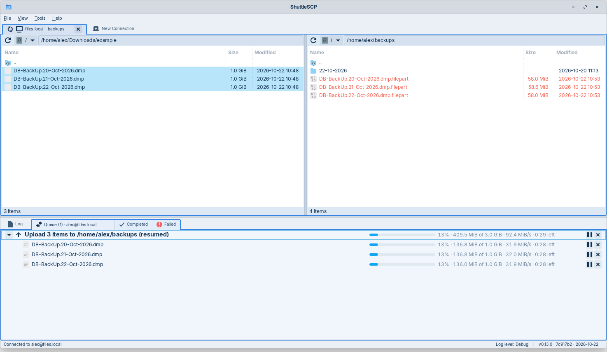

# ShuttleSCP

[](https://github.com/dsalvado/shuttlescp/actions/workflows/ci.yml)
[](https://github.com/dsalvado/shuttlescp/releases/latest)
[](LICENSE)

A graphical SFTP and FTP client for Linux, macOS and Windows, inspired by WinSCP: your computer's
files on the left, the server's on the right, and copying between them is a drag, a
right-click or a key press away.

Written in Rust with [relm4](https://relm4.org) and GTK 4.



> **Status: public beta.** It is used day to day on Linux and macOS, and the Windows
> version is new; feedback is very welcome: please
> [open an issue](https://github.com/dsalvado/shuttlescp/issues).
> See the [changelog](CHANGELOG.md) for what each release brought.

## Features

**Connections**

- SFTP and SCP over SSH, and FTP with plain, explicit or implicit TLS (FTPS), in
  passive or active mode.
- SSH login with a password, a private key file (OpenSSH or PuTTY `.ppk`, with its
  passphrase if protected) or the keys of an SSH agent (the desktop's; on Windows,
  Windows' OpenSSH agent or PuTTY's Pageant).
- Saved sites, with passwords kept in the desktop keyring (GNOME Keyring, KWallet...),
  the macOS Keychain or the Windows Credential Manager, never in a plain file.
- Export and import of sites, with saved passwords encrypted under a passphrase you
  choose, to move them to another computer.
- Several connections at once, each in its own tab with its own colour. The tab, its
  panes and its transfer lists share that colour, so it is always clear which belongs
  to which.

**Files**

- Two file panes, sortable by name, size or date, with the desktop's file icons (on
  macOS, the ones Finder shows; on Windows, Explorer's).
- On Windows, a server file whose name Windows does not allow (such as `notes:v2.txt`)
  is downloaded with the character written as `%3A`, as WinSCP does.
- A drive list on both sides: this computer's disks, and the server's (its mounted
  disks and network shares on Linux, its volumes on macOS, its drive letters on
  Windows).
- Upload, download, move, rename, delete and create folders from the right-click menu
  or the keyboard (Delete, F2).
- Drag and drop between the panes, or onto a folder in the same pane, then choose Copy
  Here or Move Here. Select several files by dragging a box over them from an empty
  spot (anywhere but a file's icon or name), as in a file manager.
- Double-click a local file to open it in its usual app.
- The local pane remembers the last folder on each disk, and the app reopens where you
  left off.

**Transfers**

- Several transfers run side by side. Each one shows its folders and files as a tree,
  with progress, speed and time left.
- Pause a transfer and resume it later, even after restarting the app, or pause, resume
  or stop single files while the rest carries on.
- A file that already exists is never replaced without asking: overwrite, skip or
  cancel, for one file or all of them.
- Interrupted transfers continue where they stopped, even after the app was closed or
  the connection dropped.
- Files being written show in red in the panes until they are complete. Finished
  transfers move to Completed or Failed, where failed ones can be retried.
- Quitting or closing a tab while transfers run asks first.

**Everything else**

- A compact interface that follows your GTK theme, light or dark. On macOS it follows
  the Mac: the menu bar at the top of the screen, window buttons on the left, the
  system's light or dark appearance, Mac-style icons.
- A log of every session and transfer, with selectable detail, shown in the app and
  kept in a file.

## Installing

### Linux

Download the AppImage from the [ShuttleSCP web page](https://shuttlescp.dsalvado.ca/)
or the [latest release](https://github.com/dsalvado/shuttlescp/releases/latest). It is one
file holding ShuttleSCP and everything it needs, for 64-bit Linux from 2020 on (it is
tested on Ubuntu 20.04, 22.04 and 24.04 and on Debian 12 and 13; Fedora, Linux Mint and
the like work the same way):

```sh
chmod +x ShuttleSCP-*-x86_64.AppImage
./ShuttleSCP-*-x86_64.AppImage
```

The first run adds ShuttleSCP to your desktop's app launcher. It checks for new versions
(at most once a day; Help › Check for Updates to check now, or to turn it off), shows a
new one in the status bar, and installs it only when it is signed with the ShuttleSCP
release key. An update can wait until running transfers finish.

### macOS

Download the disk image (`.dmg`) from the [ShuttleSCP web page](https://shuttlescp.dsalvado.ca/)
or the [latest release](https://github.com/dsalvado/shuttlescp/releases/latest), open it
and drag ShuttleSCP onto Applications. It runs on Macs with Apple silicon (M1 or later)
and macOS 14 (Sonoma) or newer.

ShuttleSCP is not signed with a paid Apple Developer ID, so the first time macOS asks to
confirm it: right-click (or Control-click) ShuttleSCP in Applications, choose Open, then
Open again. If it only offers "Move to Trash", open System Settings › Privacy & Security
and click "Open Anyway". It checks for new versions and offers to download them; it does
not replace itself.

### Windows

Download the installer (`ShuttleSCP-…-windows-x64-setup.exe`) from the
[ShuttleSCP web page](https://shuttlescp.dsalvado.ca/) or the
[latest release](https://github.com/dsalvado/shuttlescp/releases/latest) and run it. It
installs ShuttleSCP for your user only (no administrator rights needed), with a Start
menu entry and an uninstaller under Settings › Apps. It runs on 64-bit Windows 10 and 11.

The installer is not signed with a paid code-signing certificate, so the first time
Windows SmartScreen may say "Windows protected your PC": click "More info", then
"Run anyway". ShuttleSCP checks for new versions and, when you agree, downloads the new
installer (checked against the ShuttleSCP release key), runs it and restarts.

You can also build it from source, as described below.

## Building

You need:

- **Rust** 1.88 or newer ([rustup.rs](https://rustup.rs)).
- **GTK 4** (4.14 or newer) development files, and a C compiler:

  | Distribution | Command |
  |---|---|
  | Debian, Ubuntu, Mint, Zorin | `sudo apt install build-essential libgtk-4-dev` |
  | Fedora | `sudo dnf install gcc gtk4-devel` |
  | Arch, Manjaro | `sudo pacman -S base-devel gtk4` |

- To save passwords: a desktop keyring that speaks the Secret Service protocol (GNOME
  Keyring or KWallet, which most desktops already run).

On macOS, GTK 4 and the rest come from [Homebrew](https://brew.sh):
`packaging/macos/install-build-deps.sh` installs them (plus the Xcode command line
tools, `xcode-select --install`). Passwords go to the login Keychain.

On Windows, GTK 4 and the rest come from [MSYS2](https://www.msys2.org), and Rust builds
with its GNU toolchain (`rustup toolchain install stable-x86_64-pc-windows-gnu`): in an
MSYS2 UCRT64 shell, `packaging/windows/install-build-deps.sh` installs them, and
`cargo +stable-x86_64-pc-windows-gnu run --release` builds and runs it. Passwords go to
the Credential Manager. See [BUILDING.md](BUILDING.md) for the details.

Then:

```sh
git clone https://github.com/dsalvado/shuttlescp.git
cd shuttlescp
cargo run --release
```

The program is `target/release/shuttlescp`. To build the AppImage yourself, run
`packaging/linux/build-appimage.sh`; on a Mac, `packaging/macos/build-dmg.sh` builds the
self-contained app and its disk image, and `packaging/macos/run-dev.sh` runs a debug
build as an app (`cargo run` starts it without its Dock icon); on Windows,
`packaging/windows/build-bundle.sh` and `build-installer.sh` build the program folder
and its installer. See [BUILDING.md](BUILDING.md) for release builds
and the build information shown in the app, and [docs/RELEASING.md](docs/RELEASING.md)
for how releases are made, signed and published.

## Where it keeps things

| What | Where |
|---|---|
| Settings and saved sites | `~/.config/shuttlescp/` (macOS: `~/Library/Application Support/shuttlescp/`; Windows: `%APPDATA%\shuttlescp\`) |
| Log and unfinished transfers | `~/.local/state/shuttlescp/` (macOS: `~/Library/Application Support/shuttlescp/`; Windows: `%LOCALAPPDATA%\shuttlescp\`) |
| Passwords | Your desktop keyring, under "ShuttleSCP" (macOS: the login Keychain, under "shuttlescp"; Windows: the Credential Manager, under "shuttlescp:…") |

## Project layout

- `crates/shuttlescp-core`: everything that is not the user interface (sites,
  settings, the keyring, SSH, SFTP and FTP, the transfer engine, logging). It does not
  depend on GTK, so other front ends can reuse it.
- `crates/shuttlescp-gtk`: the front end for Linux, macOS and Windows, built with relm4
  and GTK 4.
- `packaging/linux`, `packaging/macos`, `packaging/windows`: the AppImage, the macOS app
  and disk image, and the Windows program folder and installer.

Run the tests with `cargo test --workspace`.

## How this was built

ShuttleSCP was built with [Claude Code](https://claude.com/claude-code), Anthropic's AI
coding agent, and I want to be upfront about that. I moved my laptop from Windows 10 to
Linux and missed WinSCP, which does not run well under Wine, so I set out to build the
tool I wanted, in Rust, and to use the project to learn modern project engineering with
AI tools.

The split of work: Claude wrote the code, tests and documentation. I decided what to
build and how it should look and behave, reviewed every change, tested it against my own
servers, and made the calls on design, security and releases (for example signed
updates, keeping the core free of GTK for other platforms, and publishing under the GPL).
Commits made with Claude carry a `Co-Authored-By: Claude` line, so the history shows
exactly which they are.

I'm David Salvador; more about me at [dsalvado.ca](https://dsalvado.ca).

## Security

Please report security problems privately, as described in [SECURITY.md](SECURITY.md),
rather than in a public issue.

## Licence

ShuttleSCP is free software: you can redistribute it and/or modify it under the terms
of the GNU General Public License as published by the Free Software Foundation, either
version 3 of the License, or (at your option) any later version. See [LICENSE](LICENSE).
